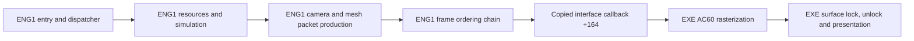

# Behavioral ENG1 reconstruction

The original host loads our source-built x86 ENG1 DLL and performs its expected
250-DWORD interface initialization. Reconstructed setup and player script
dispatch now advance the latest windowed run to missing routine `0x27d40`.
No reconstructed ENG1 gameplay frame, continuous gameplay, or normal engine
shutdown is verified.

The genuine graph has 334 mapped compiled entries, 10 explicitly traced
unindexed provider RVAs, and 364 function symbols across 174 source units.
Its 1,219 diagnostic starts/leads are not a reviewed complete first-party
denominator. The genuine link has 554 unresolved function symbols and zero
duplicate providers. The optional transitional profile adds 554 explicit
fail-on-entry diagnostics and links with zero unresolved symbols.
`PC_DLLEngineMain` is the sole PE32 export at ordinal 1. The replacement has
no original-engine import or embedded original executable code.

All 76 accepted ENG1 function instances remain exact under fresh pinned VC5
compilation and actual linked-byte comparison. This work leaves `recovery.json`
unchanged. The stable TITLE milestone and historical matching branch remain
preserved.

All 35 source fixture groups pass. The generic data gate verifies 53 providers,
910 fields and 4,787 native-matching pointer relocations. Seven boundary
regressions cover explicit read-only and mixed file/loader-zero storage.
A separate legacy-resource gate verifies 81 rows, 1,296 non-pointer bytes and
81 actual NUL-terminated path contents. These data comparisons do not establish
full array capacities, runtime ownership or historical placement.

Simulation helpers `12620/12790` pass 15 native cases/1,382 checks plus two
source guards. They reuse the existing strict `29260` frame reset rather than
reconstructing it. The fixture runs the actual source WORD interpreter and
resource reset/cancel providers in its positive-ending bounded script path.
Audio expiry and wider index/data capacities remain unverified.

Setup `15090/16790/19440` passes eight source-spy cases/43 checks; nested
endpoints are controlled and the three roots remain plausible. Helpers
`11fc0/15670` separately pass three native cases/26 checks. Measured storage
supplies 45 fields and preserves the shared DWORD-read/low-WORD-write cell
at `6ef9c`. Thirty handler targets remain missing; the 35 ordered assignments
preserve 13 table holes.

Player dispatcher `15d00` has ordinary C bodies for opcodes -52 through -1,
with explicit unknown-service and program-prefix boundaries. Eight native
cases/37 checks cover bounded default/alternate scripts, timer return, the
child orientation alias and collision-script operands. One separate source
spy checks query/RNG order and live actor reload. Instruction audits corrected
several accesses not covered by the initial tests; full opcode equivalence
and wider programs remain unverified.

Query `30010` returns the table WORD masked by the incoming low WORD, after
bit15 suppression. Four native cases keep the index zero while varying actual
writable table data and mask values; five source spies cover nonzero indices
and table reload, with two guards. An initial candidate incorrectly returned
the index, and its zero-index test hid that error. The corrected source now calls the reconstructed
`2a170` index-query dependency. Actor leaf `2a290` passes six native
cases using test-only original `20b50`; its observed upper-return path is
validated, while other arithmetic branches remain instruction-supported.

Index query `2a170` scans the live signed worklist, preserves first-hit cache
`6fedc` and actor+d8 reads, and calls reconstructed bounds/grid services.
Two native empty/negative-count cases and seven native box controls pass;
four source spies cover active traversal. Actual reads beyond the measured
worklist prefix still fail explicitly.

Grid query `20d30` passes 14 native cases/28 checks plus five source guards.
Its mutable104-byte coefficient prefix ends before the existing sequence
owner; overlapping reads remain live DWORD aliases. Only low-WORD returns
and the measured coefficient views are validated, not full index capacity.

Bounds `2a880` passes three native cases/12 checks plus eight source spies.
An output/actor alias reproduced the pre-fix y-direction error; rereading
actor+54 after x stores fixes both tested real extent paths. Extents
`30e40/31ec0` pass20 native cases/40 checks with the existing metadata/data
providers. Negative modes, null profile roots and unsupported resource IDs
fail visibly; dynamic record allocation limits remain unverified.

Grid scan `20b50` now calls the actual source decoder `20990`.
Four native cases/eight checks distinguish the y-based reverse seed and the
read after forward-scan exhaustion; one source guard is counted separately.
The decoder passes15 native cases/54 checks, including doubled masked
sample64/65/127 returns and live shared coefficient lanes. One source-only
arithmetic control and two owner guards add confidence within their scopes.
Dynamic stream and row allocation lengths remain unverified.

Resource reload retains three native cases/81 checks; dialog helpers retain
147 native cases plus a missing-NUL discriminator. Command writers retain
14 native cases. Payload decoder `4ca0` passes six synthetic/flush cases plus
the pinned private startup capture. The extracted prefix stays in ignored
`work/`; only its hash and provenance enter public evidence. Host endpoints
are controlled in these fixtures, so final pixels are unverified.

Earlier tests corrected packed-header cursor `20670` (+24) and cleanup `34d0`
(residency-state predicate). The six-case simulation-root fixture still uses
original `15780/12620` as test-only nested helpers; production has separate C
dependencies. Color retains a raw upper-DWORD callback disagreement, while
the actual host consumes the matching low byte.

Runtime evidence records 16 artifact-bound observations. Each distinguishes
historical source context from the current checkout. The latest run uses
original host/ENG3/data, stable source TITLE and the authorized no-CD change
only in a disposable host copy, in windowed mode. The observer captures the
first explicit missing operation and aborts only its owned process.

The centralized incomplete manifest distinguishes missing entries from guarded
unsupported branches and finite data prefixes. A generated body reports its
original RVA and raises a noncontinuable failure; it never returns success.
The default build omits these bodies and reports the true dependency gap.
See `docs/eng1_integration.md` for reproducible build and observation commands.

## Entry and iteration contract

The sole PC export is `PC_DLLEngineMain`, ordinal 1, RVA `0x2c180`. Its physical
ABI is cdecl `(interface_pointer, unsigned_flags)`; the EXE caller discards EAX.
Cold entry copies 250 DWORDs into ENG1's local table at `0x70f20` before checking
signature `0x5ac00cac`. Invalid input retains the initialized first-use DWORD
at `0x5b648`, allowing a retry. Native `0x2c1ad` reads source DWORD 0 once into
ECX; the loop backedge at `0x2c1bb` targets the register test at `0x2c1b1`.
It repeats that captured-value test 250 times and does not reread source memory.
The arena callback then runs and the gate clears without a callback-return
failure predicate.

Accepted calls update the host, reload the live copied context, store the full
DWORD `flags & 1` at context `+0x40`, then call dispatcher `0x20300`. Warm calls
retain the copied table and ignore their interface argument. Entry and host
forwarding fixtures pass against adopted source with test spies; they do not
validate full startup or gameplay.

Dispatcher state is a separate loader-zero DWORD at `0x6fcec`. State 0 runs
initial setup, restart setup and an iteration; state 1 runs the iteration;
other states return. A nonzero result from `0x60f9` repeats restart setup only.
Initial setup allocates resources through `0x1f0f0`; restart `0x1f320` configures
two views in one `0x2910`-byte frame allocation. Iteration toggles their pointer
at a `0x1488` stride, then increments context `+0x38`. Preserve live context
reloads and independent predicates across callbacks.

## Verified PC ownership boundary



This is native PC instruction/table evidence. ENG1 owns gameplay orchestration,
resource interpretation, camera, primitive allocation and packet links. The EXE
provides matrix/vector compatibility operations, texture storage, software
rasterization and presentation through actual copied callback pointers. A source
ENG1 swap can retain that host naturally; a rebuilt host is a separate dependency.

| Stage | Verified PC relationship | Current source state |
|---|---|---|
| Setup | `1f0f0` allocation; `1f320` frame views | Existing bootstrap/configuration/lifecycle providers; downstream initialization remains open |
| Frame reset | `5600` clears frame `+88`, resets primitive cursor | Adopted `frame_commands.c` |
| Simulation | `258e0`, `25d00`, `262a0` reach actor families and handlers | Nine orchestration/worklist bodies compiled; worklist extents and many handlers remain unresolved |
| Camera | `2fb70` follows actor `734f4`; `2f840` sets host projection state | Compiled source and measured storage; source fixtures pass |
| Geometry | `2da90 -> 2df20` transforms/culls meshes and emits linked packets | Traversal, core, three preparation functions and six primitive emitters compiled; source fixtures pass |
| Color | `5a60`, `5d50`, `5dc0`, `5e00` update RGB banks and both frame views | Compiled source; `2c830` forwards one DWORD through interface `+23c` to EXE `70c0` |
| Upload | `2cb0`, `50d0`, `58b0` use host `2c7f0` | Adopted frame commands and host wrapper; producers/resources remain dependencies |
| Submit | `2c620(frame+88)` forwards interface `+164` to EXE `ac60` | Existing dispatcher bridge; original EXE supplies consumption |
| Display | EXE `ac60` locks through `6ff0`, unlocks through `7140`, presents through `6620` | Original host owns pixels and presentation |

Important copied callbacks are `+144`/slot 81 to EXE `ac20` for pointer-chain
initialization; `+164`/89 to `ac60` for rendering; `+204`/129 to `a710` for image
rectangles; `+2b8`/174 and `+2bc`/175 to `b970`/`b990` for projection center and
focal state. Geometry wrappers use the measured host transform/project/matrix
cells. Some PC callbacks are real no-ops; retain each measured identity.

## Runtime-critical open graph

Cold startup includes source pool sweeps, descriptor/link initialization,
resource reload, payload decoding, setup and bounded player dispatch.
The latest observed frontier is `0x27d40` in the index-query chain.
Worklist, camera, geometry and dialog orchestration have compiled providers;
many collision, actor, animation and input handlers remain missing. A missing
root hides further dependencies, so the current unresolved count understates
remaining work.

Frame tables contain verified native references to both functions and data.
References need real typed providers and initialization; zero arrays, empty
bodies or fabricated success would not establish a working engine. The current
shared storage provider supplies measured cells and the producer-supported
32-WORD upload queue. Original aggregate/TU identity, complete array extents,
native DLL layout and all gameplay paths remain open.

Reproduce the current graph and bounded checks with:

```
python scripts/eng1_behavioral.py
python scripts/eng1_dependencies.py
python scripts/eng1_data_evidence.py
python scripts/test_eng1_behavioral.py
python scripts/eng1_frame_differential.py
python scripts/eng1_color_differential.py
python scripts/eng1_actor_differential.py
python scripts/eng1_forest_differential.py
python scripts/eng1_setup_differential.py
python scripts/eng1_resource_cursor_differential.py
python scripts/eng1_worklist_factory_differential.py
python scripts/eng1_descriptor_resource_differential.py
python scripts/eng1_bounded_differential.py resource-links
python scripts/eng1_bounded_differential.py command-writers
python scripts/eng1_bounded_differential.py descriptor-reload
python scripts/eng1_bounded_differential.py dialog-frame
python scripts/eng1_bounded_differential.py simulation-root
python scripts/eng1_bounded_differential.py query-decoder
python scripts/eng1_bounded_differential.py grid-scan
python scripts/eng1_bounded_differential.py extent-producer
python scripts/eng1_bounded_differential.py actor-bounds
python scripts/eng1_bounded_differential.py grid-query
python scripts/eng1_bounded_differential.py index-query
python scripts/eng1_bounded_differential.py actor-update
python scripts/eng1_bounded_differential.py query
python scripts/eng1_bounded_differential.py player-setup
python scripts/eng1_bounded_differential.py setup-leaves
python scripts/eng1_bounded_differential.py simulation-helpers
python scripts/eng1_bounded_differential.py payload-dispatch
python scripts/eng1_resource_initial_data.py
python tests/test_eng1_data_evidence_contract.py
```

The genuine profile fails at linking and leaves no stale DLL. The optional
`--include-incomplete` profile links, with every missing entry logged and failed
on execution; these definitions do not count as reconstructed functions.
The companion `evidence/eng1_pipeline.json` and validation receipt bind this
snapshot to source, configuration and PC evidence hashes. No visible gameplay
equality or whole-binary claim follows from this document.
