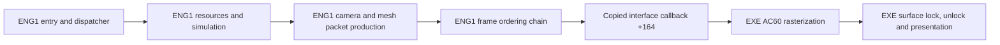

# Behavioral ENG1 reconstruction

The original host loads our source-built x86 ENG1 DLL and performs its expected
interface initialization. The current diagnostic DLL is incomplete: it contains
531 explicit fail-on-entry definitions. After reconstructing `32b10` and the
three startup pool sweeps, runtime testing exposed and corrected a two-byte
packed-header cursor error in `20670`. A new windowed run gets past that access
violation and stops at missing resource routine `3910`. No reconstructed ENG1
gameplay frame, continuous gameplay, or normal engine shutdown is verified.

The genuine graph has 299 mapped compiled entries, 10 explicitly traced
unindexed provider RVAs, and 327 function symbols across 141 source units.
Its 1,219 diagnostic starts/leads are not a reviewed complete first-party
denominator. The ordinary genuine link still has 531 missing symbols and no
duplicate owners. The optional transitional profile adds one generated source
unit and links with zero unresolved symbols; it cannot complete unknown behavior.
`PC_DLLEngineMain` is the sole PE32 export at ordinal 1. No original-engine import
or original executable code is present in the replacement source graph.

All 76 accepted ENG1 function instances remain exact under fresh pinned VC5
compilation and actual linked-byte comparison. `recovery.json` remains unchanged
by this work and is the sole authority. The stable TITLE milestone and historical
matching branch are preserved.

All 32 source fixture groups pass. Data verification passes 43 providers,
832 fields and 4,764 native-matching pointer relocations. Finite native helper,
color, empty-pool actor and forest comparisons remain recorded in the validation
receipts. The corrected resource parser passes 46 original-x86 checks on the
full shipped FOREST map; the original oracle executes only inside that fixture.
An old synthetic test had mirrored the same wrong cursor and has been corrected.
Color has one raw upper-DWORD callback disagreement; the actual host consumes
the matching low byte. These checks do not establish universal equivalence.

`evidence/eng1_runtime_validation.json` records four artifact-bound observations:
missing 32b10, missing 274e0, the resource-row access violation, and the corrected
run stopping at 3910. Each distinguishes historical source context from current
source, observes the 250-DWORD table/signature `5ac00cac`, and retains the first
failure. The last run used the original host/ENG3/data, stable source TITLE and
an authorized no-CD change solely to a disposable host copy. It was windowed.
The observer reads state/registers/stack and stops its owned process on the
first explicit incomplete operation or invalid access.

The centralized incomplete manifest distinguishes missing entries from guarded
unsupported branches and finite data prefixes. A generated body reports its
original RVA and raises a noncontinuable failure; it never returns success.
The default build omits these bodies and reports the true dependency gap.
See `docs/eng1_integration.md` for reproducible build and observation commands.

## Entry and iteration contract

The sole PC export is `PC_DLLEngineMain`, ordinal 1, RVA `0x2c180`. Its physical
ABI is cdecl `(interface_pointer, unsigned_flags)`; the EXE caller discards EAX.
Cold entry copies 250 DWORDs into ENG1's local table at `0x70f20` before checking
signature `0x5ac00cac`. Invalid input retains the initialized first-use DWORD
at `0x5b648`, allowing a retry. Native `0x2c1ad` reads source DWORD 0 once into
ECX; the loop backedge at `0x2c1bb` targets the register test at `0x2c1b1`.
It repeats that captured-value test 250 times and does not reread source memory.
The arena callback then runs and the gate clears without a callback-return
failure predicate.

Accepted calls update the host, reload the live copied context, store the full
DWORD `flags & 1` at context `+0x40`, then call dispatcher `0x20300`. Warm calls
retain the copied table and ignore their interface argument. Entry and host
forwarding fixtures pass against adopted source with test spies; they do not
validate full startup or gameplay.

Dispatcher state is a separate loader-zero DWORD at `0x6fcec`. State 0 runs
initial setup, restart setup and an iteration; state 1 runs the iteration;
other states return. A nonzero result from `0x60f9` repeats restart setup only.
Initial setup allocates resources through `0x1f0f0`; restart `0x1f320` configures
two views in one `0x2910`-byte frame allocation. Iteration toggles their pointer
at a `0x1488` stride, then increments context `+0x38`. Preserve live context
reloads and independent predicates across callbacks.

## Verified PC ownership boundary



This is native PC instruction/table evidence. ENG1 owns gameplay orchestration,
resource interpretation, camera, primitive allocation and packet links. The EXE
provides matrix/vector compatibility operations, texture storage, software
rasterization and presentation through actual copied callback pointers. A source
ENG1 swap can retain that host naturally; a rebuilt host is a separate dependency.

| Stage | Verified PC relationship | Current source state |
|---|---|---|
| Setup | `1f0f0` allocation; `1f320` frame views | Existing bootstrap/configuration/lifecycle providers; downstream initialization remains open |
| Frame reset | `5600` clears frame `+88`, resets primitive cursor | Adopted `frame_commands.c` |
| Simulation | `258e0`, `25d00`, `262a0` reach actor families and handlers | Nine orchestration/worklist bodies compiled; worklist extents and many handlers remain unresolved |
| Camera | `2fb70` follows actor `734f4`; `2f840` sets host projection state | Compiled source and measured storage; source fixtures pass |
| Geometry | `2da90 -> 2df20` transforms/culls meshes and emits linked packets | Traversal, core, three preparation functions and six primitive emitters compiled; source fixtures pass |
| Color | `5a60`, `5d50`, `5dc0`, `5e00` update RGB banks and both frame views | Compiled source; `2c830` forwards one DWORD through interface `+23c` to EXE `70c0` |
| Upload | `2cb0`, `50d0`, `58b0` use host `2c7f0` | Adopted frame commands and host wrapper; producers/resources remain dependencies |
| Submit | `2c620(frame+88)` forwards interface `+164` to EXE `ac60` | Existing dispatcher bridge; original EXE supplies consumption |
| Display | EXE `ac60` locks through `6ff0`, unlocks through `7140`, presents through `6620` | Original host owns pixels and presentation |

Important copied callbacks are `+144`/slot 81 to EXE `ac20` for pointer-chain
initialization; `+164`/89 to `ac60` for rendering; `+204`/129 to `a710` for image
rectangles; `+2b8`/174 and `+2bc`/175 to `b970`/`b990` for projection center and
focal state. Geometry wrappers use the measured host transform/project/matrix
cells. Some PC callbacks are real no-ops; retain each measured identity.

## Runtime-critical open graph

Cold startup now includes `1f750`, `5ea0`, row loading and callback setup; `32b10` and the three pool sweeps are now source-built. Observed startup next requires `3910`, resource initialization and
remaining referenced callback/data contributions. Restart and warm iteration
have compiled control, level, camera, geometry and orchestration providers, but
still lack `156a0`, `1fd90` and nested simulation/animation/collision
dependencies. A missing root hides downstream dependencies, so unresolved-symbol
count understates full work.

Frame tables contain verified native references to both functions and data.
References need real typed providers and initialization; zero arrays, empty
bodies or fabricated success would not establish a working engine. The current
shared storage provider supplies measured cells and the producer-supported
32-WORD upload queue. Original aggregate/TU identity, complete array extents,
native DLL layout and all gameplay paths remain open.

Reproduce the current graph and bounded checks with:

```
python scripts/eng1_behavioral.py
python scripts/eng1_dependencies.py
python scripts/eng1_data_evidence.py
python scripts/test_eng1_behavioral.py
python scripts/eng1_frame_differential.py
python scripts/eng1_color_differential.py
python scripts/eng1_actor_differential.py
python scripts/eng1_forest_differential.py
python scripts/eng1_setup_differential.py
python scripts/eng1_resource_cursor_differential.py
```

The genuine profile fails at linking and leaves no stale DLL. The optional
`--include-incomplete` profile links, with every missing entry logged and failed
on execution; these definitions do not count as reconstructed functions.
The companion `evidence/eng1_pipeline.json` and validation receipt bind this
snapshot to source, configuration and PC evidence hashes. No visible gameplay
equality or whole-binary claim follows from this document.
