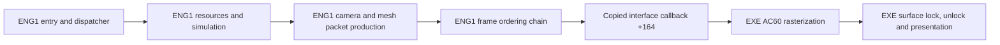

# Behavioral ENG1 reconstruction

ENG1 is a partial source graph on `codex/eng1-behavioral-reconstruction`.
The current link fails with 539 unresolved symbols. No reconstructed ENG1
DLL has been loaded by the game. TITLE remains at its working milestone;
`recovery.json` remains the sole recovery authority and all 76 existing strict
instances pass fresh historical compilation and byte comparison.

The diagnostic inventory has 1,219 starts/leads, of which
290 have mapped compiled source definitions, plus
10 explicitly traced unindexed provider RVAs.
This is not a reviewed complete first-party denominator or playable percentage.
There are 318 compiled function symbols across 132 source units.
The 116 existing recovery rows remain 76 `FUNCTION_MATCH`, 39 `CODEGEN_SIMILAR`
and one `RECONSTRUCTED`; this behavioral work grants no additional exact-match state.

Fresh data verification passes for 39 providers, 827 measured fields
and 4,764 pointer relocations. It checks contents, pointer positions, actual target
RVAs and addends, including configuration tables. Loaded zero-fill equivalence
is permitted only for one explicitly documented native zero WORD. It does not
prove complete runtime capacities or original linker placement.

All 26 source fixture groups pass, including camera, geometry, mesh traversal,
interpreters, startup/resource callbacks and finite spatial-read guards. Native
frame-helper comparisons pass 15 cases and 178 checks. Color comparisons pass
2,484 states and 36,001 checks under the actual host low-byte callback contract;
one raw callback DWORD differs in unused upper bits and remains recorded as a
diagnostic disagreement. Actor pipeline `258e0` passes 512 cases and 6,662 checks
with zero pool bounds and the empty kind-owner path. That comparison corrected
sine-table byte/index arithmetic and six omitted worklist clears. Nonzero actor
populations, geometry against native execution, and live gameplay remain unverified.
Forest worklist construction `26040` also passes an unpatched native differential
using all 283 actual FOREST placements, alongside synthetic callback states.
The combined forest fixture passes 44 cases and 203 checks; `26480` actor creation
uses source spies and its dispatched factory/action bodies remain missing.

The centralized incomplete manifest records 68 unsupported branches or data
reads. Guards log the original RVA and fail before unsupported continuation.
Missing functions remain unresolved; no missing body silently reports success.
Finite data prefixes and five zero-readable address identities are
transitional source contributions, not recovered full capacities.

An isolated windowed integration stage is prepared with the stable source TITLE,
original ENG3/data and an authorized no-CD adjustment only to its disposable EXE.
The bounded observer is source built. Preparation does not establish a game launch.
See `docs/eng1_integration.md` for reproducible staging and observation commands.

## Entry and iteration contract

The sole PC export is `PC_DLLEngineMain`, ordinal 1, RVA `0x2c180`. Its physical
ABI is cdecl `(interface_pointer, unsigned_flags)`; the EXE caller discards EAX.
Cold entry copies 250 DWORDs into ENG1's local table at `0x70f20` before checking
signature `0x5ac00cac`. Invalid input retains the initialized first-use DWORD
at `0x5b648`, allowing a retry. Native `0x2c1ad` reads source DWORD 0 once into
ECX; the loop backedge at `0x2c1bb` targets the register test at `0x2c1b1`.
It repeats that captured-value test 250 times and does not reread source memory.
The arena callback then runs and the gate clears without a callback-return
failure predicate.

Accepted calls update the host, reload the live copied context, store the full
DWORD `flags & 1` at context `+0x40`, then call dispatcher `0x20300`. Warm calls
retain the copied table and ignore their interface argument. Entry and host
forwarding fixtures pass against adopted source with test spies; they do not
validate full startup or gameplay.

Dispatcher state is a separate loader-zero DWORD at `0x6fcec`. State 0 runs
initial setup, restart setup and an iteration; state 1 runs the iteration;
other states return. A nonzero result from `0x60f9` repeats restart setup only.
Initial setup allocates resources through `0x1f0f0`; restart `0x1f320` configures
two views in one `0x2910`-byte frame allocation. Iteration toggles their pointer
at a `0x1488` stride, then increments context `+0x38`. Preserve live context
reloads and independent predicates across callbacks.

## Verified PC ownership boundary



This is native PC instruction/table evidence. ENG1 owns gameplay orchestration,
resource interpretation, camera, primitive allocation and packet links. The EXE
provides matrix/vector compatibility operations, texture storage, software
rasterization and presentation through actual copied callback pointers. A source
ENG1 swap can retain that host naturally; a rebuilt host is a separate dependency.

| Stage | Verified PC relationship | Current source state |
|---|---|---|
| Setup | `1f0f0` allocation; `1f320` frame views | Existing bootstrap/configuration/lifecycle providers; downstream initialization remains open |
| Frame reset | `5600` clears frame `+88`, resets primitive cursor | Adopted `frame_commands.c` |
| Simulation | `258e0`, `25d00`, `262a0` reach actor families and handlers | Nine orchestration/worklist bodies compiled; worklist extents and many handlers remain unresolved |
| Camera | `2fb70` follows actor `734f4`; `2f840` sets host projection state | Compiled source and measured storage; source fixtures pass |
| Geometry | `2da90 -> 2df20` transforms/culls meshes and emits linked packets | Traversal, core, three preparation functions and six primitive emitters compiled; source fixtures pass |
| Color | `5a60`, `5d50`, `5dc0`, `5e00` update RGB banks and both frame views | Compiled source; `2c830` forwards one DWORD through interface `+23c` to EXE `70c0` |
| Upload | `2cb0`, `50d0`, `58b0` use host `2c7f0` | Adopted frame commands and host wrapper; producers/resources remain dependencies |
| Submit | `2c620(frame+88)` forwards interface `+164` to EXE `ac60` | Existing dispatcher bridge; original EXE supplies consumption |
| Display | EXE `ac60` locks through `6ff0`, unlocks through `7140`, presents through `6620` | Original host owns pixels and presentation |

Important copied callbacks are `+144`/slot 81 to EXE `ac20` for pointer-chain
initialization; `+164`/89 to `ac60` for rendering; `+204`/129 to `a710` for image
rectangles; `+2b8`/174 and `+2bc`/175 to `b970`/`b990` for projection center and
focal state. Geometry wrappers use the measured host transform/project/matrix
cells. Some PC callbacks are real no-ops; retain each measured identity.

## Runtime-critical open graph

Cold startup now includes `1f750`, `5ea0`, row loading and callback setup; it still requires `32b10`, resource initialization and
remaining referenced callback/data contributions. Restart and warm iteration
have compiled control, level, camera, geometry and orchestration providers, but
still lack `156a0`, `1fd90` and nested simulation/animation/collision
dependencies. A missing root hides downstream dependencies, so unresolved-symbol
count understates full work.

Frame tables contain verified native references to both functions and data.
References need real typed providers and initialization; zero arrays, empty
bodies or fabricated success would not establish a working engine. The current
shared storage provider supplies measured cells and the producer-supported
32-WORD upload queue. Original aggregate/TU identity, complete array extents,
native DLL layout and all gameplay paths remain open.

Reproduce the current graph and bounded checks with:

```
python scripts/eng1_behavioral.py
python scripts/eng1_dependencies.py
python scripts/eng1_data_evidence.py
python scripts/test_eng1_behavioral.py
python scripts/eng1_frame_differential.py
python scripts/eng1_color_differential.py
python scripts/eng1_actor_differential.py
python scripts/eng1_forest_differential.py
```

The build currently fails at linking and deliberately leaves no stale DLL.
The companion `evidence/eng1_pipeline.json` and validation receipt bind this
snapshot to source, configuration and PC evidence hashes. No visible gameplay
equality or whole-binary claim follows from this document.
