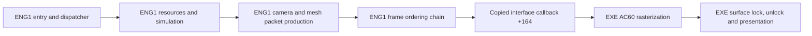

# Behavioral ENG1 reconstruction

The original host loads our source-built x86 ENG1 DLL and performs its expected
250-DWORD interface initialization. The current transitional DLL contains 524
explicit fail-on-entry definitions. Reconstructed resource reload `33e0/3410`
and payload decoder `4ca0` advance the latest windowed run to missing routine
`15090`. No reconstructed ENG1 gameplay frame, continuous gameplay, or normal
engine shutdown is verified.

The genuine graph has 316 mapped compiled entries, 10 explicitly traced
unindexed provider RVAs, and 346 function symbols across 155 source units.
Its 1,219 diagnostic starts/leads are not a reviewed complete first-party
denominator. The ordinary genuine link has 524 unresolved symbols and zero
duplicate owners. The optional transitional profile adds generated diagnostics
and links with zero unresolved symbols. `PC_DLLEngineMain` is the sole PE32
export at ordinal 1. The replacement has no original-engine import or embedded
original executable code.

All 76 accepted ENG1 function instances remain exact under fresh pinned VC5
compilation and actual linked-byte comparison. This work leaves `recovery.json`
unchanged. The stable TITLE milestone and historical matching branch remain
preserved.

All 34 source fixture groups pass. The generic data gate verifies 47 providers,
856 fields and 4,779 native-matching pointer relocations. Its seven boundary
regressions cover explicit read-only classification and mixed file/loader-zero
storage. A separate fresh legacy-resource gate verifies all 81 rows, 1,296
non-pointer bytes and 81 actual NUL-terminated path contents; these are outside
the generic count. Neither data gate proves native placement or full runtime
ownership. Color retains one raw upper-DWORD callback disagreement; the actual
host consumes the matching low byte.

Resource reload uses actual provider/completion source and passes three cases,
81 native checks. Dialog helpers `1f40`, `2450`, `24d0`, `2c60` and `2c9b0`
pass 147 finite native cases plus a missing-NUL guard discriminator. The tests
cover live context/frame/cursor changes, mutable scripts and pointer cells,
post-callback glyph width, and DWORD wrap. Command writers retain 14 passing
native cases; host rendering endpoints are controlled spies, so pixel output
is unverified. Simulation root `156a0` passes six cases/36 checks, but its
standalone fixture still executes original `15780` and `12620` as nested
helpers. Production retains those as separate source dependencies.

Payload decoder `4ca0` passes four synthetic controls and two real-source flush
cases. A seventh case uses the privately captured first-game input and matches
the return `0021`, all 256 link rows, queue/cursor, decode scratch and bounded
frame owner. The capture is a stack candidate matched to a verified source CALL,
not an entry breakpoint or complete live-global snapshot. Its 128-byte prefix
remains under ignored `work/`; public evidence records its hash and provenance.
Queue flushing preserves the first key and resumes at coordinate zero.

Earlier tests exposed and corrected packed-header cursor `20670` (`+24`, not
`+26`) and cleanup `34d0` (residency state, not entry count). The real worklist
factories pass six native cases/48 checks, descriptor scan passes 54 checks,
and link initialization passes 6,146 checks. Wider simulation, collision,
animation, audio and resource paths remain incomplete or unverified.

`evidence/eng1_runtime_validation.json` records nine artifact-bound observations,
including the historical access violation, two stops at `4ca0` (one with a
read-only call capture), and the new `15090` stop. Each distinguishes historical
source context from current source. The latest run uses original host/ENG3/data,
stable source TITLE and the authorized no-CD change only in a disposable host
copy. It is windowed. The observer captures state and aborts its owned process
on the first explicit incomplete operation or invalid access.

The centralized incomplete manifest distinguishes missing entries from guarded
unsupported branches and finite data prefixes. A generated body reports its
original RVA and raises a noncontinuable failure; it never returns success.
The default build omits these bodies and reports the true dependency gap.
See `docs/eng1_integration.md` for reproducible build and observation commands.

## Entry and iteration contract

The sole PC export is `PC_DLLEngineMain`, ordinal 1, RVA `0x2c180`. Its physical
ABI is cdecl `(interface_pointer, unsigned_flags)`; the EXE caller discards EAX.
Cold entry copies 250 DWORDs into ENG1's local table at `0x70f20` before checking
signature `0x5ac00cac`. Invalid input retains the initialized first-use DWORD
at `0x5b648`, allowing a retry. Native `0x2c1ad` reads source DWORD 0 once into
ECX; the loop backedge at `0x2c1bb` targets the register test at `0x2c1b1`.
It repeats that captured-value test 250 times and does not reread source memory.
The arena callback then runs and the gate clears without a callback-return
failure predicate.

Accepted calls update the host, reload the live copied context, store the full
DWORD `flags & 1` at context `+0x40`, then call dispatcher `0x20300`. Warm calls
retain the copied table and ignore their interface argument. Entry and host
forwarding fixtures pass against adopted source with test spies; they do not
validate full startup or gameplay.

Dispatcher state is a separate loader-zero DWORD at `0x6fcec`. State 0 runs
initial setup, restart setup and an iteration; state 1 runs the iteration;
other states return. A nonzero result from `0x60f9` repeats restart setup only.
Initial setup allocates resources through `0x1f0f0`; restart `0x1f320` configures
two views in one `0x2910`-byte frame allocation. Iteration toggles their pointer
at a `0x1488` stride, then increments context `+0x38`. Preserve live context
reloads and independent predicates across callbacks.

## Verified PC ownership boundary



This is native PC instruction/table evidence. ENG1 owns gameplay orchestration,
resource interpretation, camera, primitive allocation and packet links. The EXE
provides matrix/vector compatibility operations, texture storage, software
rasterization and presentation through actual copied callback pointers. A source
ENG1 swap can retain that host naturally; a rebuilt host is a separate dependency.

| Stage | Verified PC relationship | Current source state |
|---|---|---|
| Setup | `1f0f0` allocation; `1f320` frame views | Existing bootstrap/configuration/lifecycle providers; downstream initialization remains open |
| Frame reset | `5600` clears frame `+88`, resets primitive cursor | Adopted `frame_commands.c` |
| Simulation | `258e0`, `25d00`, `262a0` reach actor families and handlers | Nine orchestration/worklist bodies compiled; worklist extents and many handlers remain unresolved |
| Camera | `2fb70` follows actor `734f4`; `2f840` sets host projection state | Compiled source and measured storage; source fixtures pass |
| Geometry | `2da90 -> 2df20` transforms/culls meshes and emits linked packets | Traversal, core, three preparation functions and six primitive emitters compiled; source fixtures pass |
| Color | `5a60`, `5d50`, `5dc0`, `5e00` update RGB banks and both frame views | Compiled source; `2c830` forwards one DWORD through interface `+23c` to EXE `70c0` |
| Upload | `2cb0`, `50d0`, `58b0` use host `2c7f0` | Adopted frame commands and host wrapper; producers/resources remain dependencies |
| Submit | `2c620(frame+88)` forwards interface `+164` to EXE `ac60` | Existing dispatcher bridge; original EXE supplies consumption |
| Display | EXE `ac60` locks through `6ff0`, unlocks through `7140`, presents through `6620` | Original host owns pixels and presentation |

Important copied callbacks are `+144`/slot 81 to EXE `ac20` for pointer-chain
initialization; `+164`/89 to `ac60` for rendering; `+204`/129 to `a710` for image
rectangles; `+2b8`/174 and `+2bc`/175 to `b970`/`b990` for projection center and
focal state. Geometry wrappers use the measured host transform/project/matrix
cells. Some PC callbacks are real no-ops; retain each measured identity.

## Runtime-critical open graph

Cold startup includes the source pool sweeps, descriptor scan/link initializer,
resource reload and payload decoder. The first observed missing routine is now
`15090`. Restart and warm iteration have compiled control, level, camera,
geometry, dialog and orchestration providers. Roots `156a0` and `1fd90` are
source-built; nested `15780`, `12620` and further simulation/animation/collision
dependencies remain open. A missing root hides downstream dependencies, so unresolved-symbol
count understates full work.

Frame tables contain verified native references to both functions and data.
References need real typed providers and initialization; zero arrays, empty
bodies or fabricated success would not establish a working engine. The current
shared storage provider supplies measured cells and the producer-supported
32-WORD upload queue. Original aggregate/TU identity, complete array extents,
native DLL layout and all gameplay paths remain open.

Reproduce the current graph and bounded checks with:

```
python scripts/eng1_behavioral.py
python scripts/eng1_dependencies.py
python scripts/eng1_data_evidence.py
python scripts/test_eng1_behavioral.py
python scripts/eng1_frame_differential.py
python scripts/eng1_color_differential.py
python scripts/eng1_actor_differential.py
python scripts/eng1_forest_differential.py
python scripts/eng1_setup_differential.py
python scripts/eng1_resource_cursor_differential.py
python scripts/eng1_worklist_factory_differential.py
python scripts/eng1_descriptor_resource_differential.py
python scripts/eng1_bounded_differential.py resource-links
python scripts/eng1_bounded_differential.py command-writers
python scripts/eng1_bounded_differential.py descriptor-reload
python scripts/eng1_bounded_differential.py dialog-frame
python scripts/eng1_bounded_differential.py simulation-root
python scripts/eng1_bounded_differential.py payload-dispatch
python scripts/eng1_resource_initial_data.py
python tests/test_eng1_data_evidence_contract.py
```

The genuine profile fails at linking and leaves no stale DLL. The optional
`--include-incomplete` profile links, with every missing entry logged and failed
on execution; these definitions do not count as reconstructed functions.
The companion `evidence/eng1_pipeline.json` and validation receipt bind this
snapshot to source, configuration and PC evidence hashes. No visible gameplay
equality or whole-binary claim follows from this document.
