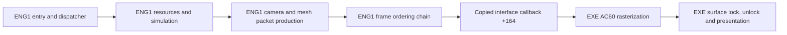

# Behavioral ENG1 reconstruction

The current genuine source graph does not link a runnable ENG1 DLL. Earlier
transitional host probes reported interface initialization and a fail-on-entry
frontier at `0x28290`; that routine now has reconstructed source, but this does
not establish a later runtime frontier. No new original-host run, reconstructed
gameplay frame, continuous gameplay, or normal engine shutdown is verified.

The latest genuine graph has 367 mapped compiled entries and 398 function
symbols. See `evidence/eng1_zero_angle_step.json` for its pinned private receipt.
Its 1,219 diagnostic starts/leads are not a reviewed complete first-party
denominator. The genuine link has 531 unresolved symbols and zero duplicate
providers. Its intended export is `PC_DLLEngineMain` at ordinal 1; no current
DLL is produced. Earlier transitional links used explicit fail-on-entry
diagnostics, which do not supply game dependencies.

All 76 accepted ENG1 function instances remain exact under fresh pinned VC5
compilation and complete raw contribution comparison. All 132 accepted
functions across modules pass the same strict check. This work leaves `recovery.json`
unchanged. The stable TITLE milestone and historical matching branch remain
preserved.

All 38 source fixture groups pass. The generic data gate verifies 59 providers,
923 fields and 4,787 native-matching pointer relocations. Seven boundary
regressions cover explicit read-only and mixed file/loader-zero storage.
A separate legacy-resource gate verifies 81 rows, 1,296 non-pointer bytes and
81 actual NUL-terminated path contents. These data comparisons do not establish
full array capacities, runtime ownership or historical placement.

The animation-triple interpreter at `0x28aa0` now preserves a raw angle WORD
when its control step is zero. The prior source incorrectly masked such angles
to ten bits. Original instruction branches and a failing prior-source fixture
establish the discrepancy; fresh canonical VC5 source passes two direct cases
and the successful private `0x1b9a0` command pipeline, with 42 checks. These
compare exact ticks, returns, control records and complete actor bytes, allowing
only measured pointer identities to differ. The integrated fixture uses actual
source command/frame/interpreter providers and audits live callback effects.
The broader opcode/helper closure and whole-function byte equality remain open.
Evidence, predictions, source hashes and replay commands are in
`evidence/eng1_zero_angle_step.json`.

Simulation helpers `12620/12790` pass 15 native cases/1,382 checks plus two
source guards. They reuse the existing strict `29260` frame reset rather than
reconstructing it. The fixture runs the actual source WORD interpreter and
resource reset/cancel providers in its positive-ending bounded script path.
Audio expiry and wider index/data capacities remain unverified.

Setup `15090/16790/19440` passes eight source-spy cases/43 checks; nested
endpoints are controlled and the three roots remain plausible. Helpers
`11fc0/15670` separately pass three native cases/26 checks. Measured storage
supplies 45 fields and preserves the shared DWORD-read/low-WORD-write cell
at `6ef9c`. Thirty handler targets remain missing; the 35 ordered assignments
preserve 13 table holes.

Player dispatcher `15d00` has ordinary C bodies for opcodes -52 through -1,
with explicit unknown-service and program-prefix boundaries. Eight native
cases/37 checks cover bounded default/alternate scripts, timer return, the
child orientation alias and collision-script operands. One separate source
spy checks query/RNG order and live actor reload. Instruction audits corrected
several accesses not covered by the initial tests; full opcode equivalence
and wider programs remain unverified.

Query `30010` returns the table WORD masked by the incoming low WORD, after
bit15 suppression. Four native cases keep the index zero while varying actual
writable table data and mask values; five source spies cover nonzero indices
and table reload, with two guards. An initial candidate incorrectly returned
the index, and its zero-index test hid that error. The corrected source now calls the reconstructed
`2a170` index-query dependency. Actor leaf `2a290` passes six native
cases using test-only original `20b50`; its observed upper-return path is
validated, while other arithmetic branches remain instruction-supported.

Index query `2a170` scans the live signed worklist, preserves first-hit cache
`6fedc` and actor+d8 reads, and calls reconstructed bounds/grid services.
Two native empty/negative-count cases and seven native box controls pass;
four source spies cover active traversal. Actual reads beyond the measured
worklist prefix still fail explicitly.

Grid query `20d30` passes 14 native cases/28 checks plus five source guards.
Its mutable104-byte coefficient prefix ends before the existing sequence
owner; overlapping reads remain live DWORD aliases. Only low-WORD returns
and the measured coefficient views are validated, not full index capacity.

Bounds `2a880` passes three native cases/12 checks plus eight source spies.
An output/actor alias reproduced the pre-fix y-direction error; rereading
actor+54 after x stores fixes both tested real extent paths. Extents
`30e40/31ec0` pass20 native cases/40 checks with the existing metadata/data
providers. Negative modes, null profile roots and unsupported resource IDs
fail visibly; dynamic record allocation limits remain unverified.

Grid scan `20b50` now calls the actual source decoder `20990`.
Four native cases/eight checks distinguish the y-based reverse seed and the
read after forward-scan exhaustion; one source guard is counted separately.
The decoder passes15 native cases/54 checks, including doubled masked
sample64/65/127 returns and live shared coefficient lanes. One source-only
arithmetic control and two owner guards add confidence within their scopes.
Dynamic stream and row allocation lengths remain unverified.

Child-link wrapper `27d40` reuses the existing factory, allocator,
initializer and detach sources. Five native cases/104 checks cover blocked,
successful, exhausted and parent/pool alias states. Configuration mirrors
and eight synthetic asset rows are controlled fixture state; the cleanup
endpoint is restricted to a zero-kind no-op. Wider data and cleanup remain
unverified.

Spawn services `300c0/30180` and middle factory `277e0` now have source.
Six selector-family invocations and two allocation-failure controls pass39
assertions using the configured production allocator/initializer providers.
Normal owner copy/chain, middle owner copy without chain, and alternate
owner omission are retained. `300c0` returns the created actor; `30180` uses
the known direct callers' void contract. Three indirect wrapper paths
propagate raw callback EAX. A separate finite native audit found no semantic
use in the reviewed indirect graph; dynamic target completeness and raw
EAX equality remain unproved.

Actor bootstrap `1e50` reuses normal-pool slot1 and the existing descriptor,
camera and callback owners. Three native comparisons/24 checks cover zero
kind, callback actor/table reloads, a nonzero descriptor subrow and the `03ff`
kind mask. Five unsupported-state source guards pass. Its descriptor reads
remain live through the ordered stores. The actual host completed this routine
and reached the next startup dependency; full configuration coverage is unproved.

Alternate bootstrap `12960` initializes eight records, offsets `128..534`
at stride `94`, using the existing initializer and WORD-slot owner. Three
native comparisons/987 checks cover the original data, live lookup mutations
and zero lookup values, full pool buffers and canaries. One null-pool guard
is separately counted. The new mutable `52b50` owner covers exactly32 bytes
before the existing `52b70` owner. The failed initial seven-record interpretation
is preserved; full arbitrary allocation capacity remains unproved.

Level initializer `3ca10` reuses the command-table allocator and existing
pipeline/camera cells. Two native comparisons/4,660 checks cover successful
and partially failed allocation, callback-visible pre/post state, live mutations
and command slot ownership. Its sound pointer targets a mutable 16-byte WORD
prefix ending before the separate `66d78` command stream. Source guards reject
crossing that boundary and arithmetic overflow; the prefix is statically measured.

Level update `3ca50` passes all 65,536 WORD values/131,072 checks against native,
including output-adjacent canaries. The `70f0c` WORD is an exact interior view
of the measured 56-byte loader-zero control owner, while its native `2cd30` writer has a plausible source body and `3ecb0` remains
missing. Exhaustive leaf behavior does not prove live selector state or gameplay.

Actor initializer `2cc50` passes three native cases / 7,833 checks with
actual frame-advance, actor-update and grid sources. State and pipeline aliases
test store ordering; selector `70f0c` remains unchanged. One 56-byte control
owner preserves WORD/DWORD overlap. Its new six-pair motion prefix is 24 bytes
and stops at the distinct `5c3b8` lookup root; guards reject wider motion reads.
Active grid states and wider motion indices remain unverified.

Startup actor callback `12c00` passes five native actor comparisons and two
source-only dispatch/order probes (21 aggregate checks). The complete `12d10`
helper falls through from `2a290` to `ef10`; only context level 9 returns early.
Native lookup loads precede frame-state writes. The original failed candidate
and its missed fall-through remain recorded; wider kind/owner prefixes fail
explicitly. Its real downstream `ef10` now passes five native comparisons /
25 checks using the source grid query, covering signed z and low-WORD result
boundaries. Raw EAX and broader query states remain unverified.

Actor control `2cd30` is plausible and instruction-audited, with ten source-only
spy scenarios. Its native body has not been differentially executed. The
separate one-DWORD cdecl classifier `41fd0` matches AL for all 65,536 high-WORD
patterns with low WORD zero and the original table; two source-only mutated-key
controls check initial sentinel and unsupported scan. A positive input at the
final sentinel returns row 17. Mutable threshold rows and selector words retain
their measured 216-byte and 80-byte owners. Unsupported scans and uninitialized
collision pointers report and abort. Tail callbacks `2d3f0/2d440` now have source;
17 finite native comparisons and two initial-owner comparisons pass. The actual
frame selector is reused. Opcode-only scan reads remain WORD-sized; operand
preflight occurs only when native logic reads the operand. Audio-triggering
variants, opcodes 5/6/9 and arbitrary scripts remain unverified.

Existing sound provider `6da0` was corrected from measured native evidence:
failed channel allocation preserves actor+6c. Four event/channel combinations
pass 132 comparisons through the actual source callback wrappers. Broader audio
modes and audibility remain unverified.

Actor script initializer `13990` passes 20 actual-source native comparisons /
100 checks through the existing reset, interpreter, update and grid providers.
These cover the equality-selected 44-WORD prefix at `53370` and an inactive
grid sentinel. The adjacent `533c8` pool remains a separate owner. Both exact
program roots have measured prefix guards; alternate-program behavior remains
unverified. Earlier test-only original-service forwarding supports outer stores
and order, not source closure. The windowed host passed `13990` in v27 and
reached `3ca80`; the latest artifact-bound observation below records its context.

Forest actor callback 3ca80 now reuses the actual classifier, list producer
and existing registry. Nineteen native actor comparisons cover rows 0..17 on
null input and one empty-group success. The class byte is at +21, distinct
from Actor.category at +22; only kind-30 children consume cached mask bits.
Nonempty child iteration, live count mutation and child-kind changes remain
instruction-supported and unverified.
A separate source-only child-loop scenario passes19 checks over seven ordered
events. It injects list growth and class/kind changes around the actual child
state and frame providers to distinguish live reloads and mask alignment.
These injected controls do not establish native nonempty-loop equivalence.

List producer 2b130 preserves null exits without clearing +120; only
post-acquisition failure releases the group and clears that cell. Five native
cases /45 checks use actual registry acquire/release for early/null/empty and
rollback states. Factory success, callback mutations and dynamic allocation
capacity remain unverified. The native requested allocation includes the count
DWORD and may be smaller than the maximum append; allocation rounding is
unknown and has not been hidden with an invented extra slot.

Child-state helper 41000 passes nine native comparisons /99 checks through
the existing source frame selector. Unsigned states at least eight become16;
zero becomes1. Low bits0/1 select frame0,2 selects1,3 selects2. The original
failed draft inverted the threshold and mapped frames incorrectly; those
discriminators and high-bit WORD controls are preserved.

Owned-spawn callback40e20 has a source wrapper around existing frame advance
and owner-aware spawn providers. Two native cases /17 checks compare successful
and exhausted normal allocation with the existing kind34 render callback.
Seven separate source-only checks inject a frame-helper coordinate mutation
and verify post-call z/y/x reads and the same owner. Dynamic return consumers,
arbitrary pool/frame capacities and broader production callbacks remain unproved.

The successful list-producer extension compares all three factory families
against native under a shared synthetic mutation callback: three pairs /99
grouped checks cover coordinate wrap, initialized state, live count append,
cached sprite and replacement record-base reload. These are finite call-site
controls and real factory/pool behavior; the synthetic callback does not validate
production callback semantics or allocation capacity.

Attachment callback3e220 passes three native cases /28 checks with real frame,
attachment, factory and pool providers. It captures unsigned state only after
both frame helpers, writes the high WORD at ee while preserving ec/ed and f0,
then retains attachment-callback mutations after return. Eight separate
source-only checks inject helper-state changes to discriminate order.
The existing26-slot65b28 frame prefix already covers index13; no owner extension.

Two spatial-effect dependency spellings now bind to existing source bodies at
ef10 and2a290 with the same one-pointer cdecl command view. Their original
behavioral limits remain unchanged. A separate identity audit distinguishes
unresolved spellings and duplicate native addresses; no missing binding
overlapped mapped library contributions longer than16 bytes in that snapshot.
The heuristic inventory and library cutoff still do not prove a complete
first-party census.

Alternate initializer 0xefa0 passes two native cases and 29 checks using the
actual reset and WORD interpreter providers. Eight reviewed initializer
configurations share the existing six-byte program at 0x51b20. Its tested
reads are index 1 then 0; actor comparison normalizes only the program pointer.
The callback reads render flags before overwriting flags, stores the mode byte
before render flags, and retains the narrow store at +0x4a before reset.
Other programs and consumers of the incidental EAX return remain unproved.

Position initializer 0x2d9b0 passes ten native/source actor comparisons and 62
checks with the existing 0x41fd0 helper and 216-byte classifier table. It keeps
the saved x across DWORD y/z writes, then stores AL at +0x21 while preserving
category +0x22 and adjacent canaries. Tests cover threshold edges, varied low
WORDs and signed nonpositive sentinel outcomes. The first fixture expected
0xff for positive high WORD 0x7fff; both source and native selected row 17.
The failed receipt is preserved. Existing alternate callback record 41 is
reused, and its NULL program is valid here. Universal callback EAX and arbitrary
mutable table inputs remain unproved.

State initializer 0x40a50 passes ten original/source actor comparisons and 81
checks. It ORs render flags before capturing the state WORD. Independent bits
0x0100, 0x0200 and 0x0400 retain their ordered WORD/DWORD stores, including both
writes to +0xdc when selected. Bit 0x0800 selects step 0x100 or 0x300. The
magnitude remains a raw DWORD containing the low five bits. Tests cover both
step sizes, combined branches and adjacent canaries; +0xe0 and the adjacent
WORD at +0x72 remain intact. Existing middle callback records 49/52 are reused.
The first mask transcription error was corrected before experiments and kept
by hash. Broader combinations and incidental callback EAX remain unproved.

Tile packet writer 0x2ff0 passes five original/source cases and 26 checks for
finite test-owned grids and output buffers. It preserves signed clipping,
column wrap, joined runs, four packet kinds, both frame lists and live cursor
updates. Nonzero values distinguish the live WORD at 0x73480 and packet +0x0e
store. A separate zero-width case compares the x86 divide-error exception under
the pinned VC5 compiler. Only known pointer fields are normalized; other bytes
are compared directly. Production allocation extents and pixel output remain
unproved. A measured two-byte mutable zero-fill owner supplies 0x73480 without
owning its neighboring gap or the existing cursor.

Frame palette callback 0x42320 and RGB helper 0x5a30 pass eight original/source
comparisons and 43 checks: three direct RGB pairs and five complete call-chain
pairs using actual tile, storage and color units with a zero-height grid.
Camera X and Y are captured in native order; signed shift, wrapped subtraction,
division toward zero, post-call Y reload and threshold 32 are retained. The
RGB helper stores red, reads the signed frame WORD, stores green/blue, then
calls the existing 0x5e00 writer. Broader resource/frame capacities, incidental
EAX and pixel-level rendering remain unproved. Earlier source-only and
native-only receipts remain preserved separately.

The collision pointer has one source definition in a pure data unit, moved
unchanged from mixed runtime storage; normal setup supplies its actor address.
The independent DWORD countdown gate is loader-zero. Its five native writers
remain incomplete. Static zero equality establishes neither pointer lifetime
nor countdown behavior. The data gate still requires every public definition
and relocation in each measured provider to have evidence.

Resource reload retains three native cases/81 checks; dialog helpers retain
147 native cases plus a missing-NUL discriminator. Command writers retain
14 native cases. Payload decoder `4ca0` passes six synthetic/flush cases plus
the pinned private startup capture. The extracted prefix stays in ignored
`work/`; only its hash and provenance enter public evidence. Host endpoints
are controlled in these fixtures, so final pixels are unverified.

Earlier tests corrected packed-header cursor `20670` (+24) and cleanup `34d0`
(residency-state predicate). The six-case simulation-root fixture still uses
original `15780/12620` as test-only nested helpers; production has separate C
dependencies. Color retains a raw upper-DWORD callback disagreement, while
the actual host consumes the matching low byte.

Runtime evidence records 31 artifact-bound observations. Each distinguishes
historical source context from the current checkout. The latest run uses
original host/ENG3/data, stable source TITLE and the authorized no-CD change
only in a disposable host copy, in windowed mode. The observer captures the
first explicit missing operation and aborts only its owned process.

The centralized incomplete manifest distinguishes missing entries from guarded
unsupported branches and finite data prefixes. A generated body reports its
original RVA and raises a noncontinuable failure; it never returns success.
The default build omits these bodies and reports the true dependency gap.
See `docs/eng1_integration.md` for reproducible build and observation commands.

## Entry and iteration contract

The sole PC export is `PC_DLLEngineMain`, ordinal 1, RVA `0x2c180`. Its physical
ABI is cdecl `(interface_pointer, unsigned_flags)`; the EXE caller discards EAX.
Cold entry copies 250 DWORDs into ENG1's local table at `0x70f20` before checking
signature `0x5ac00cac`. Invalid input retains the initialized first-use DWORD
at `0x5b648`, allowing a retry. Native `0x2c1ad` reads source DWORD 0 once into
ECX; the loop backedge at `0x2c1bb` targets the register test at `0x2c1b1`.
It repeats that captured-value test 250 times and does not reread source memory.
The arena callback then runs and the gate clears without a callback-return
failure predicate.

Accepted calls update the host, reload the live copied context, store the full
DWORD `flags & 1` at context `+0x40`, then call dispatcher `0x20300`. Warm calls
retain the copied table and ignore their interface argument. Entry and host
forwarding fixtures pass against adopted source with test spies; they do not
validate full startup or gameplay.

Dispatcher state is a separate loader-zero DWORD at `0x6fcec`. State 0 runs
initial setup, restart setup and an iteration; state 1 runs the iteration;
other states return. A nonzero result from `0x60f9` repeats restart setup only.
Initial setup allocates resources through `0x1f0f0`; restart `0x1f320` configures
two views in one `0x2910`-byte frame allocation. Iteration toggles their pointer
at a `0x1488` stride, then increments context `+0x38`. Preserve live context
reloads and independent predicates across callbacks.

## Verified PC ownership boundary



This is native PC instruction/table evidence. ENG1 owns gameplay orchestration,
resource interpretation, camera, primitive allocation and packet links. The EXE
provides matrix/vector compatibility operations, texture storage, software
rasterization and presentation through actual copied callback pointers. A source
ENG1 swap can retain that host naturally; a rebuilt host is a separate dependency.

| Stage | Verified PC relationship | Current source state |
|---|---|---|
| Setup | `1f0f0` allocation; `1f320` frame views | Existing bootstrap/configuration/lifecycle providers; downstream initialization remains open |
| Frame reset | `5600` clears frame `+88`, resets primitive cursor | Adopted `frame_commands.c` |
| Simulation | `258e0`, `25d00`, `262a0` reach actor families and handlers | Nine orchestration/worklist bodies compiled; worklist extents and many handlers remain unresolved |
| Camera | `2fb70` follows actor `734f4`; `2f840` sets host projection state | Compiled source and measured storage; source fixtures pass |
| Geometry | `2da90 -> 2df20` transforms/culls meshes and emits linked packets | Traversal, core, three preparation functions and six primitive emitters compiled; source fixtures pass |
| Color | `5a60`, `5d50`, `5dc0`, `5e00` update RGB banks and both frame views | Compiled source; `2c830` forwards one DWORD through interface `+23c` to EXE `70c0` |
| Upload | `2cb0`, `50d0`, `58b0` use host `2c7f0` | Adopted frame commands and host wrapper; producers/resources remain dependencies |
| Submit | `2c620(frame+88)` forwards interface `+164` to EXE `ac60` | Existing dispatcher bridge; original EXE supplies consumption |
| Display | EXE `ac60` locks through `6ff0`, unlocks through `7140`, presents through `6620` | Original host owns pixels and presentation |

Important copied callbacks are `+144`/slot 81 to EXE `ac20` for pointer-chain
initialization; `+164`/89 to `ac60` for rendering; `+204`/129 to `a710` for image
rectangles; `+2b8`/174 and `+2bc`/175 to `b970`/`b990` for projection center and
focal state. Geometry wrappers use the measured host transform/project/matrix
cells. Some PC callbacks are real no-ops; retain each measured identity.

## Runtime-critical open graph

Cold startup includes source pool sweeps, descriptor/link initialization,
resource reload, payload decoding, setup and bounded player dispatch.
The latest observed frontier is `0x28290` in the startup chain.
Worklist, camera, geometry and dialog orchestration have compiled providers;
many collision, actor, animation and input handlers remain missing. A missing
root hides further dependencies, so the current unresolved count understates
remaining work.

Frame tables contain verified native references to both functions and data.
References need real typed providers and initialization; zero arrays, empty
bodies or fabricated success would not establish a working engine. The current
shared storage provider supplies measured cells and the producer-supported
32-WORD upload queue. Original aggregate/TU identity, complete array extents,
native DLL layout and all gameplay paths remain open.

Reproduce the current graph and bounded checks with:

```
python scripts/eng1_behavioral.py
python scripts/eng1_dependencies.py
python scripts/eng1_data_evidence.py
python scripts/test_eng1_behavioral.py
python scripts/eng1_frame_differential.py
python scripts/eng1_color_differential.py
python scripts/eng1_actor_differential.py
python scripts/eng1_forest_differential.py
python scripts/eng1_setup_differential.py
python scripts/eng1_resource_cursor_differential.py
python scripts/eng1_worklist_factory_differential.py
python scripts/eng1_descriptor_resource_differential.py
python scripts/eng1_bounded_differential.py resource-links
python scripts/eng1_bounded_differential.py command-writers
python scripts/eng1_bounded_differential.py descriptor-reload
python scripts/eng1_bounded_differential.py dialog-frame
python scripts/eng1_bounded_differential.py simulation-root
python scripts/eng1_bounded_differential.py frame-palette
python scripts/eng1_bounded_differential.py tile-draw
python scripts/eng1_bounded_differential.py state-initializer
python scripts/eng1_bounded_differential.py position-initializer
python scripts/eng1_bounded_differential.py alternate-initializer
python scripts/eng1_bounded_differential.py attachment-callback
python scripts/eng1_bounded_differential.py owned-spawn-callback
python scripts/eng1_bounded_differential.py actor-list-producer
python scripts/eng1_bounded_differential.py forest-actor-callback
python scripts/eng1_bounded_differential.py classifier-child
python scripts/eng1_bounded_differential.py actor-script-initializer
python scripts/eng1_bounded_differential.py audio-event
python scripts/eng1_bounded_differential.py actor-tail
python scripts/eng1_bounded_differential.py z-query
python scripts/eng1_bounded_differential.py actor-control
python scripts/eng1_bounded_differential.py startup-callback
python scripts/eng1_bounded_differential.py actor-initializer
python scripts/eng1_bounded_differential.py forest-update
python scripts/eng1_bounded_differential.py forest-initializer
python scripts/eng1_bounded_differential.py alternate-bootstrap
python scripts/eng1_bounded_differential.py actor-bootstrap
python scripts/eng1_bounded_differential.py spawn-services
python scripts/eng1_bounded_differential.py action-spawn
python scripts/eng1_bounded_differential.py query-decoder
python scripts/eng1_bounded_differential.py grid-scan
python scripts/eng1_bounded_differential.py extent-producer
python scripts/eng1_bounded_differential.py actor-bounds
python scripts/eng1_bounded_differential.py grid-query
python scripts/eng1_bounded_differential.py index-query
python scripts/eng1_bounded_differential.py actor-update
python scripts/eng1_bounded_differential.py query
python scripts/eng1_bounded_differential.py player-setup
python scripts/eng1_bounded_differential.py setup-leaves
python scripts/eng1_bounded_differential.py simulation-helpers
python scripts/eng1_bounded_differential.py payload-dispatch
python scripts/eng1_resource_initial_data.py
python tests/test_eng1_data_evidence_contract.py
```

The genuine profile fails at linking and leaves no stale DLL. The optional
`--include-incomplete` profile links, with every missing entry logged and failed
on execution; these definitions do not count as reconstructed functions.
The companion `evidence/eng1_pipeline.json` and validation receipt bind this
snapshot to source, configuration and PC evidence hashes. No visible gameplay
equality or whole-binary claim follows from this document.
