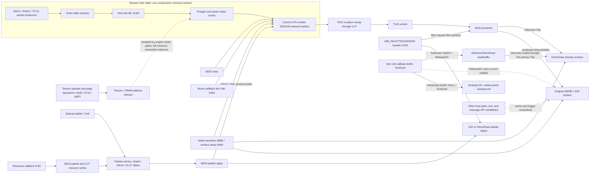

# Screen writer ownership

The original display has one shared, already-composited 320×240 indexed image. The packet and producer evidence establishes command shapes and write routes; it does not establish separate world, UI, or overlay layers. A native-resolution implementation must account for the complete current image and the independent host writers below. An opaque full-frame overlay would replace the shared image rather than reproduce its ownership.

Windowed mode uses a top-down 8-bit DIB at `0x96E3D8`, with pitch 320 and bitmap information at `0x96E3F4`. In fullscreen mode, the locked attached DirectDraw backbuffer is published through `0xBA0210` and its pitch through `0xBA0214`; the pitch is taken from the successful lock. The view is valid while the lock byte `0xBA01F0` is set. Unlocking clears the byte but leaves stale pointer and pitch cells.

The order table is walked in ascending bucket order; because producers prepend records, links within a bucket are visited in reverse prepend order. Host table slot 89 binds to `0xAC60` (cell RVA `0x3631C`). The static module dispatches are ENG1 `0x2C625`, ENG3 `0x1FC35`, and TITLE `0xC6B5`. Command group `0x20` routes polygon-compatible records through `0xD420` or `0xE680`; group `0x60` routes sprite-compatible records through `0xCAB0` or `0xC8F0`, with tag bit 1 selecting each route. Example producers include ENG1 mesh `0x2DF20` and tile `0x2FF0`, ENG3 variable sprite `0x72A0`, and TITLE FT4-compatible writers `0x17F50`, `0x181E0`, `0x186E0`, and `0x18BF0`. These command families do not identify semantic layers.

| Writer or operation | Source and destination | Format, coordinates, and order | Lock, dirty, and proof limits |
|---|---|---|---|
| Packet consumer `0xAC60`; polygon `0xD420`/`0xE680`; sprite `0xCAB0`/`0xC8F0` | Slot-89 order-table records write the current `0xBA0210` view | 320×240, 8-bit indexed bytes; packet XY/UV/size/color fields; ascending buckets and reverse prepend order within a bucket | AC60 optionally calls clear `0x6EE0` at `0xAC8A`, locks through `0x6FF0` at `0xAC92`, rasterizes, calls `0x70C0(0xFF)` at `0xB2D0`, unlocks through `0x7140` at `0xB2D8`, presents through `0x6620` at `0xB2DD`, then callback `0xBD80` at `0xB2E2`. Nonzero `0xBA01FC` skips pixel services but not packet traversal/callbacks. Dirty byte `0x43A590` is a sticky present request. Callback `0xA8F0` may reenter `0xBD80`; AC60 reloads its link at `0xACA2`. No final pixels or semantic layers are established. |
| Clear `0x6EE0` | Clear color/palette lookup or DirectDraw color-fill; writes the locked DIB view or fullscreen attached surface | Whole 320×240 byte view in the DIB path; fullscreen uses surface color fill | Called by AC60 at `0xAC8A` or by `0x69A0` at `0x69B6`. It can overwrite earlier pixels; cross-callback serialization is unknown. |
| Remap `0x70C0` | Current pixel byte plus lookup table at `0x91C488`; writes the same CPU-visible view in place | `0xFF` maps 76,800 bytes using the current row pitch | AC60 calls it after rasterization and before unlock. It does not acquire/release the lock or change dirty byte `0x43A590`. Its table aliases broader shade/CLUT state. |
| Movie callback `0x5450` | TITLE copied-table slot 148 at `0xC9EA`; movie ID and raw control word; host opens/decodes into its own buffer and writes the current pitched view | Indexed width-by-height copy from `(0,0)`, source pitch equals decoded width, destination pitch comes from the lock; dimensions come from the movie header, with capacities and source lifetime unresolved | Calls palette entry writer `0x6780` at `0x55C2`, `0x69A0(0)` at `0x55D8`, lock `0x6FF0` at `0x55E8`, sets dirty at `0x566B`, unlocks at `0x5672`, and presents at `0x5677`. A later branch calls `0x6780` at `0x570A` and `0x69A0(1)` at `0x5720`. This is an independent route outside slot 89. |
| Resource palette callback `0x5760`; resource writer `0x68C0` | Host table slot 145 calls `0x5760`; it calls `0x68C0` at `0x59E5`, then palette apply `0x69A0(1)` at `0x59EF` | Resource-loaded palette and translation-table data; destinations include palette entries through `0x6780`, blend `0x92E3D0..0x96E3D0`, shade `0x91C488..0x92C488`, and CLUT `0x92C490..0x92E490` | These are palette/LUT writes, not framebuffer bytes. Resource reads, values, and runtime trigger are unknown; table ranges alias. |
| Startup LUT builder `0x71A0` | Host graphics initialization calls it at `0x741A`, before DirectDraw creation at `0x7426` and before the first observed engine-table dispatch | Builds palette entries and procedural shade/blend/CLUT data | Calls `0x69A0(1)` at `0x728F`; startup ordering is static, while external initialization timing remains an integration concern. |
| Palette entry writer `0x6780`; apply/clear/present `0x69A0` | `0x6780` writes through palette pointer `0x96E3F8`; `0x69A0` applies to GDI or DirectDraw palette objects | One 8-bit palette index/RGB entry; `0x69A0` processes 256 entries | `0x69A0` orders `0x7140` unlock, `0x6EE0` clear, `0x6620` present, then mode-specific palette application. No global transaction fence among independent callers is proven. |
| Texture upload/page writers `0xA640`, `0xA710`, `0xA8F0` | Slots 130, 129, and 131 respectively; `0xA640` calls `0xA710` at `0xA675`; AC60 command 1 calls `0xA8F0` at `0xB1E7` | Native texture/page address operations with caller-supplied rectangles and page state; resource-derived bounds are not established | These destinations are distinct from the published CPU view in the bounded evidence, though actual texture ranges are not shown to be exclusive. Do not treat a memory-address envelope as an allocation boundary. |
| Host text callback `0x6440` | Host table slot 149 (cell RVA `0x3640C`); windowed `GetDC(NULL)` then `TextOutA`, followed by `ReleaseDC(current HWND, HDC)`; fullscreen attached-backbuffer DC methods at vtable `+0x44`/`+0x68` | ANSI `(%c) %s ` format; caller-supplied x/y; one-byte counter increments modulo 256; font and clipping are unknown | `TextOutA` callsites are `0x64B7` and `0x650C`. Five native-body fixtures with synthetic endpoints verify the arguments, failure branches and absence of direct framebuffer/dirty writes; they establish no actual Windows pixels. Trigger and owner are **unknown / not established**. The old selected-dispatch receipt has no slot-149 entries in ENG1/ENG3/TITLE, and a targeted exact-cell scan found no decoded direct call/jmp operands in those three `.text` sections. This does not prove slot 149 unreachable: computed/register-relative calls, runtime mutation, other code and external routes remain open. |
| Presenter `0x6620`; mode transition `0x6BB0`; surface setup `0x6A60` | `0x6620` outputs the shared DIB or DirectDraw primary; mode transition changes HWND and display/surface state; setup is called at `0x6D01` | Windowed `StretchDIBits` at `0x66A0` sends the 320×240 DIB to `[0,0,0xBA0220,0xBA0224]`, then `GdiFlush` at `0x66A6`; fullscreen flips; fallback `FillRect` at `0x66DD` paints the client area black | Presenter tests and clears dirty at `0x6637` before output. Mode transition invalidates at `0x6E92` and presents at `0x6E9F`. No actual Windows/GDI/DirectDraw call was made; message and reentrant timing remain unknown. |
| Palette message handler `0x6700` and other paint/message paths | `0x6700` handles `WM_PALETTECHANGED` (`0x311`); targeted host imports also show text, paint, blit, HDC, and message API call candidates | Selects/realizes the GDI palette, marks dirty at `0x675D`, then presents at `0x6764`; other imported calls carry API-specific HDC/window arguments | WndProc owner and dispatch chain are unresolved. The audit records 33 targeted direct-import groups but does not traverse MFC ownership or prove each candidate reachable. Computed calls, subclasses, external code, and OS reentrancy are open. |
| MCI route | Bounded `WINMM!mciSendStringA` calls and literals address `cdaudio` open/status/stop/play/close operations | Audio track/time commands; bounded calls pass a zero callback HWND | These bounded strings do not show an MCI video-window writer or CPU-frame/palette write. Other MCI commands, runtime-loaded components, and unrelated external writers are not excluded. |

The slot-149 scan prediction was that a decoded absolute `call`/`jmp` operand to a copied slot-149 cell in any of the three module `.text` sections would reveal a concrete table-trigger candidate and falsify the old empty selected-dispatch result for that route. The scan tested the exact copied-cell VAs `0x10071174`, `0x100409F4`, and `0x1002BD94`; it found none. It does not scan all aliases or establish a closed call graph.

The pinned historical inventory and provenance are in [evidence/screen_ownership.json](evidence/screen_ownership.json). Its `/inventory/writers/14/destination/windowed` description incorrectly says `GetDC(original HWND)`; the later [text-writer evidence](gdi_text_writer.md) supersedes that description with the observed literal NULL argument. The historical JSON remains unchanged. Replay its hash, span, import-candidate, and exact-cell gates with [audit_screen_ownership.py](tests/audit_screen_ownership.py). That audit does not execute game code or claim runtime reachability, serialization, complete writer closure, whole-binary identity, or actual OS presentation.

The [movie-writer audit](movie_writer.md) extends the historical inventory:
slot148 takes a resource request rather than a TITLE frame/palette pointer.
The host's copy begins at the locked-view origin, with no clipping check in
the pinned body. Palette changes clear/present before applying the palette;
the callback also pumps messages. File dimensions, buffer capacity, decoder
thread timing and cross-callback serialization remain unresolved. This static
route is independent of AC60 and does not prove exclusive image ownership.
